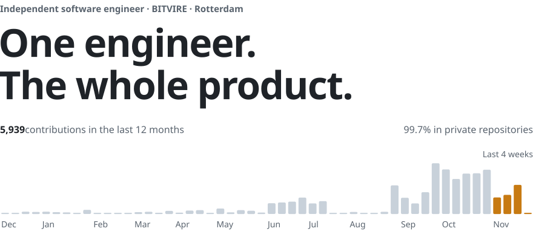
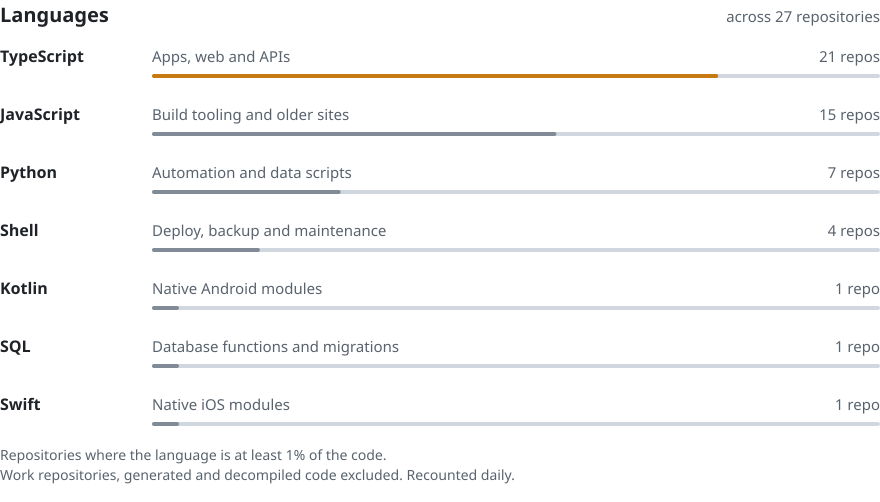

<picture>
  <source media="(prefers-color-scheme: dark) and (max-width: 600px)" srcset="cards/header-narrow-dark.svg">
  <source media="(prefers-color-scheme: light) and (max-width: 600px)" srcset="cards/header-narrow-light.svg">
  <source media="(prefers-color-scheme: dark)" srcset="cards/header-wide-dark.svg">
  
</picture>

Mobile, TV and web apps, the APIs behind them and the infrastructure they run on, from first schema to production.

<a href="https://bitvire.com">bitvire.com</a>

<picture>
  <source media="(prefers-color-scheme: dark) and (max-width: 600px)" srcset="cards/stack-narrow-dark.svg">
  <source media="(prefers-color-scheme: light) and (max-width: 600px)" srcset="cards/stack-narrow-light.svg">
  <source media="(prefers-color-scheme: dark)" srcset="cards/stack-wide-dark.svg">
  
</picture>

<picture>
  <source media="(prefers-color-scheme: dark) and (max-width: 600px)" srcset="cards/languages-narrow-dark.svg">
  <source media="(prefers-color-scheme: light) and (max-width: 600px)" srcset="cards/languages-narrow-light.svg">
  <source media="(prefers-color-scheme: dark)" srcset="cards/languages-wide-dark.svg">
  
</picture>

Rebuilt daily from the GitHub API. Private repositories are counted, not listed.

